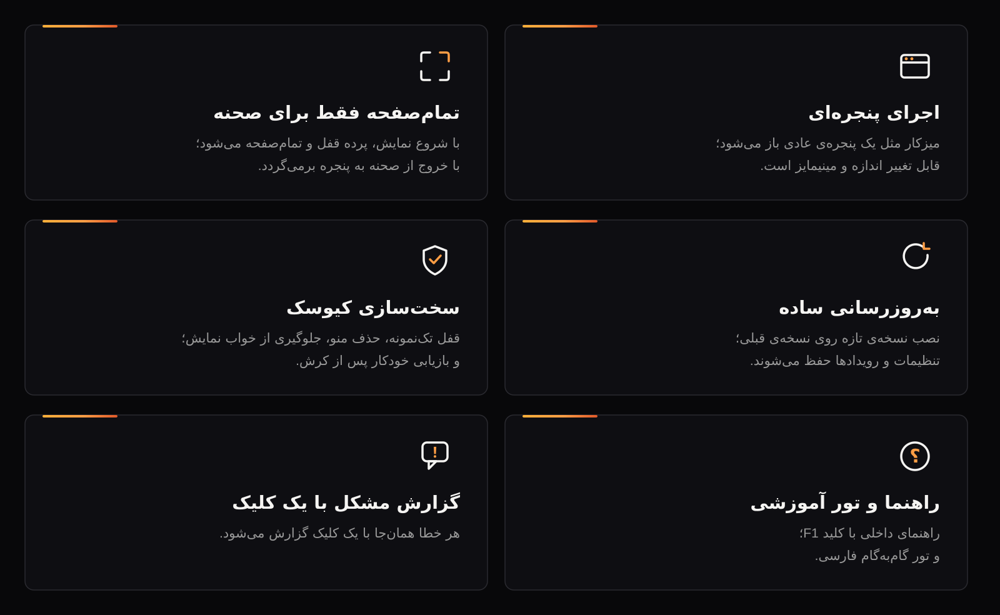

**استودیو تایمر رویداد** — ابزار شمارش معکوس رویداد با تقویم جلالی، پیش‌نمایش صحنه و تور آموزشی؛ برای اجرای زنده‌ی رویدادها روی ویندوز.

| نسخه‌ی فعلی | حجم فایل | سیستم‌عامل | اتصال |
|:---:|:---:|:---:|:---:|
| 0.5.0 | حدود ۸۳ مگابایت | ویندوز ۱۰/۱۱ (۶۴ بیتی) | کاملاً آفلاین |

## دانلود

<a href="https://github.com/IRDcode/event-timer-distribution/releases/latest" style="display:inline-block; background:#F5F4F2; color:#0B0B0C; padding:14px 36px; border-radius:8px; font-weight:700; text-decoration:none; font-size:18px;">دانلود آخرین نسخه — 0.5.0</a>

- فایل نصب: `Event.Timer.Studio-0.5.0-setup.exe`
- فقط فایل `setup.exe` را دانلود کنید؛ `latest.yml` و `.blockmap` مخصوص به‌روزرسانی خودکار برنامه‌اند.
- شرح تغییرات هر نسخه، در صفحه‌ی همان انتشار نوشته شده است.

## نصب

1. فایل `setup.exe` را اجرا کنید.
2. ویندوز ۱۰ یا ۱۱، نسخه‌ی ۶۴ بیتی — پیش‌نیاز دیگری لازم نیست.
3. نصب نسخه‌ی تازه روی نسخه‌ی قبلی، همان نصب را به‌روز می‌کند؛ تنظیمات و رویدادها دست‌نخورده می‌مانند.

## فعال‌سازی

برنامه برای اجرا به کلید فعال‌سازی نیاز دارد؛ کلید را از صادرکننده‌ی آن دریافت کنید.

## به‌روزرسانی

برنامه در هر باز شدن — در صورت اتصال اینترنت — همین صفحه را بررسی می‌کند. اگر نسخه‌ی تازه‌تری منتشر شده باشد، دکمه‌ی «نسخه‌ی تازه آماده است» در نوار پایین برنامه ظاهر می‌شود.

## حریم خصوصی

برنامه کاملاً آفلاین کار می‌کند؛ هیچ داده‌ای از دستگاه شما خارج نمی‌شود.

## پشتیبانی

irdkiyacode@gmail.com

---

© کیارش جوانبخت — IRDcode · تمام حقوق محفوظ است.

